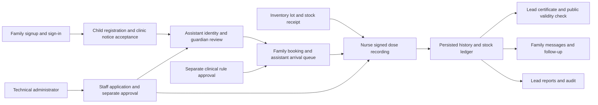

# Normal local accounts and connected-flow audit — 2026-10-14

## Scope and current status

The user selected the normal application at http://localhost:3000, accounts for every existing role, and Technical administrator as the developer role. They subsequently authorized working example identities and a populated patient record without supplying actual people's details. These are persistent application records, clearly marked as examples, not a separate persona system or presentation launcher.

The normal app has seven requested accounts: Family, Technical administrator, Clinical lead, Nurse/Clinical staff, Registration assistant, Inventory clerk and Health worker. An additional pre-existing account was preserved. All six staff accounts have active independently approved memberships and verified MFA. Passwords and actual MFA secrets are only in ignored `.local/local-login-credentials.json`; none are included here.

The family account has Luis Reyes (Example), born 2024-06-15, record CV-000001. Registration and family linkage persist; the assistant can search/open the record. Identity/guardian verification intentionally remains pending. No vaccination event or stock transaction was invented, and no fictional clinical schedule was imported into the normal database. An explicitly educational notice describes this example-only local workspace; an actual clinic must supply its own approved notice and rules before actual patient use.

| Account role | Saved example profile |
|---|---|
| Family | Maria Reyes (Example) |
| Technical administrator / developer | Andrea Cruz (Example) |
| Clinical lead | Liza Mendoza (Example) |
| Nurse / clinical staff | Carlo Santos (Example) |
| Registration assistant | Nina Garcia (Example) |
| Inventory clerk | Paolo Ramos (Example) |
| Health worker | Rosa Cruz (Example) |

Earlier full-system source and data-integrity evidence remains in [the prior verification report](2026-10-14-local-verification.md), [frontend/source coverage](2026-10-14-frontend-module-coverage.md) and [backend/shared-library coverage](2026-10-14-backend-module-coverage.md). Those reports describe their earlier snapshots; their two-staff/zero-child main counts and removed demo commands are historical, not current instructions.

## Connected application flow

Every operation follows the existing client/form → same-origin API → session/MFA/schema validation → allowlisted RPC → database capability/RLS/transaction/audit → response → refreshed page chain. The app uses real local Supabase Auth/PostgREST/PostgreSQL. Family account creation is immediately confirmed without confirmation email. Verified guardian relationships and staff MFA are separate authorization requirements.

Actual normal-account provisioning used `/auth/sign-up`, `/api/v1/me/profile`, staff applications and their accept/approve commands. Clinical staff was accepted by Technical administrator and approved by Clinical lead; non-clinical roles were accepted by Clinical lead and approved by Technical administrator. No direct membership insertion or another first-staff bootstrap was used. The child was registered through the family form after notice acceptance; no existing patient was overwritten.

## Feature and workflow evidence

| Feature/workflow | Intended behavior | Actual findings | Status | Change | Evidence |
|---|---|---|---|---|---|
| Normal account signup | Persist real Auth identity with immediate access | Five additional accounts created, existing admin/lead reused | PASS | Operator provisioning only | `.local/audit-normal-accounts-retry.log` |
| Staff application/access/MFA | Independent acceptance/approval and second-step access | Four new roles granted through normal commands; six staff MFA factors verified | PASS | No permission bypass | Same log; role workspace checks |
| Family/admin role boundaries | Family cannot manage staff; Technical admin cannot read clinical records | Actual APIs deny both | PASS | Existing policy preserved | Provisioning assertions |
| Every requested workspace | Correct role landing, readable empty states, reload persistence | All seven roles pass at 375/1280 px with no axe A/AA violations/overflow | PASS | Existing UI preserved | `.local/audit-normal-role-pages-final.log` |
| Names and patient linkage | Save account names and linked child in the normal app | Named examples; family card and assistant search/open persist | PASS | Account profile updates and one example registration | `.local/audit-normal-example-patient.log` |
| Clinic/guardian verification | Staff verify before full family clinical access | Example registration remains provisional | NOT RUN on this example | Teacher can perform the existing review step | Stored relationship assertion; isolated regression coverage |
| Booking/queue/dose/history/stock | Use approved clinic rules and actual available stock | No rules, stock or doses fabricated in the normal app | BLOCKED on normal clinic configuration | Existing implementation preserved | Prior isolated integration evidence; current regression below |
| Evidence/corrections/guardian links | Review and persist changes without leaking access | Existing isolated journeys pass in the corrected regression | PASS in isolated tests | No product change in this transition | `.local/audit-normal-e2e-retry.log` |
| Certificates/public verification/messages | Frozen signed PDF, private details withheld, durable notices | Existing journeys and freshly collected connected flow pass | PASS in isolated tests | Test precondition issues a new certificate, retains revoked evidence | `.local/audit-normal-connected-flow-final.log` |
| Inventory/transfers/cold-chain/counts | Transactional units, custody and separate approval | Prior data and browser evidence retained | Prior PASS; no schema change | No new clinical/stock records here | Prior verification report |
| Reports/admin/care/follow-up/outage forms | Role-scoped persisted results and exports | Existing journeys and connected flow pass | PASS in isolated tests | No product change | Current regression logs |
| Normal restart | Preserve accounts/grants/MFA and records | Both account-only and populated profile/patient/guardian snapshots match after ordinary restart | PASS | No reset | `.local/audit-normal-restart.log`; `.local/audit-normal-patient-restart.log` |

## Changes and issue register

| ID | Priority/type | Evidence and root cause | Resolution | Verification |
|---|---|---|---|---|
| NORMAL-01 | P2 scope/usability | Teacher needed normal saved accounts rather than a separate presentation launcher | Removed `scripts/demo.ts`, four package demo commands, launch entry and launcher-only unit test; no app route depended on them | Caller/manifest/launch self-check; types/lint/unit pass |
| NORMAL-02 | P2 account setup | Main had only two staff roles; full role flow inaccessible | Added four staff accounts and one family account through ordinary signup/applications/approvals, with actual MFA | Seven role sign-ins; API denials; normal persistence |
| NORMAL-03 | P2 test integration | Removing the launcher would leave eight connected-flow tests permanently skipped | Renamed to `12-full-flow.spec.ts`, removed demo gate; normal isolated E2E now collects 51 tests. New certificate precondition preserves the earlier revoked document rather than changing its state | Eight freshly collected steps pass |
| TEST-APPROVAL-01 | P2 regression timing | A global persistent “Approved” notice from the first staff member satisfied the second wait; immediate reload could interrupt the second request. The BHW remained pending, and dependent tests lacked saved MFA | Wait for each named staff row to become Active and its approval button to disappear; original later persistence assertions retained | The corrected approval and all 42 existing journeys pass |
| TEST-CERTIFICATE-01 | P2 test contract | The newly added prerequisite asserted API status `valid`; the existing issue API actually returns `issued`, while family/public UI displays validity | Assert the actual `issued` response and retain the later UI “Valid” check | Fresh setup and all eight connected steps pass |

The connected-flow setup also accounts for the prior access-removal journey: if the assistant no longer has active access, the Clinical lead requests a new grant and the Technical administrator independently approves it through real APIs. The revoked row and all preceding refusal assertions/audit history remain intact; no owner update reverses that test's revocation.

No source application behavior, API response contract, migration, installed dependency or lockfile was changed by this transition. No main database reset, old identity deletion, clinical fixture import, commit, push or deployment occurred. Isolated E2E/database fixtures remain because they protect the normal records during regression tests. The old professor guide remains as a historical pointer to [the classroom walkthrough](../operations/classroom-walkthrough.md).

The obsolete ignored `.local/e2e/demo-accounts.json` was removed after confirming no current source, test, operator guide or audit helper used it. It described the removed launcher and a reset test database. Normal credentials and every existing actual identity remain intact.

Provisioning initially navigated before an MFA redirect finished; the audit helper now waits for the actual destination and resumes saved accounts. A role-count check initially counted an unrelated pre-existing account; it now verifies the seven requested identities specifically and reports eight total. Neither issue required an application change or deletion of the extra identity.

## Verification and limits

**Fresh recheck:** [2026-10-14 local recheck](2026-10-14-local-recheck.md) subsequently passed all **51 browser cases together in one clean run**, plus types/lint, 592 unit tests, 427 database tests, build and upgrade/restore drills. The intermediate results below remain historical evidence; their full-suite rerun caveat is now closed. Normal configuration and human screen-reader requirements remain open.

- PASS: `npm run check`: types/lint and 592 unit tests across 80 files. The launcher-only unit test was removed because its launcher is removed; assertions for the retained application were not deleted.
- PASS: seven real normal role workspaces at 375/1280 px; correct landing, reload, no automated A/AA issues and no horizontal overflow.
- PASS: actual staff approval/MFA, family/admin API denials, account names, linked example registration and staff search.
- PASS: ordinary main restart returns readiness HTTP 200 on loopback ::1 with unchanged saved role/MFA snapshot.
- PASS: populated example patient and guardian/profile hashes match after ordinary restart; family and assistant patient views pass automated accessibility/overflow at 375/1280 px, and provisional family history remains denied.

The normal family desktop card and assistant phone record were also visually inspected in captured viewport screenshots; saved example name, DOB and record number are readable. This does not substitute for a human screen reader.
- Initial `npm run test:e2e`: FAIL, 37 passed / 7 failed / 7 did not run, exposing TEST-APPROVAL-01 and TEST-CERTIFICATE-01; log retained.
- Corrected `npm run test:e2e`: 45 passed / 1 failed / 5 did not run. All 42 existing journeys and the opened-state accessibility test pass. The connected-flow setup collected for this run still lacked the later assistant regrant, so its third step failed after the earlier revocation test. This is not reported as a clean full-suite pass.
- Fresh targeted collection: `npx tsx .local/run-isolated-existing-flows.ts 12-full-flow.spec.ts`: PASS, all eight connected steps in 1.5 minutes, including actual regrant, registration, booking/queue, signed dose/stock, PDF/public validity/messages, reports/admin and follow-up/forms. Existing isolated fixtures and certificate signing key were preserved; no main records were used.
- Combined current evidence: all **51 distinct browser cases** have passing evidence (42 existing + one opened-state accessibility + eight connected-flow cases). The final setup adjustment was tested by focused fresh collection; the full 51-case command was not rerun after that adjustment. Failed intermediate logs remain disclosed.
- PASS: `npm run matrix:check`: 287 rows current. Final `npm run check` again passes types/lint and all 592 unit tests after the setup was frozen.
- Prior PASS, not rerun for this scripts/docs/accounts transition: 427 database tests, final production build, 48-migration install/upgrade/restore and 331-source-module coverage. Schema/application source is unchanged.
- BLOCKED: actual screen-reader speech, approved normal-clinic medical rules and a complete patient vaccination workflow on that clinic. Automated accessibility cannot supply spoken-reader evidence; example identities are not actual medical history.
- NOT RUN: public deployment, real camera, physical printer or hosted/external transport. These remain outside the laptop-only changes.

## Normal use and next steps

Use `npm run dev`, http://localhost:3000/sign-in for Family and http://localhost:3000/evactrackstafflogin for staff. Private names/emails/passwords/MFA secrets and the example patient record are in `.local/local-login-credentials.json`. Import each staff secret into an authenticator; do not put this file or codes on a projector.

Begin with the example patient's pending verification and the clinic setup screens. Booking, signing vaccination and certificates require the clinic's approved rules/products, usable stock, a session and the required reviewed record. Follow [the normal classroom walkthrough](../operations/classroom-walkthrough.md); do not invent vaccinations or bypass these gates merely to fill screens.

Required remaining work: perform the normal example's clinic/guardian review and supply approved clinic rules/products, usable stock and a session for the intended clinical walkthrough; obtain an observed screen-reader result. These are not replaced by fictional vaccination history. Optional future hosting, transport, pagination and hardware work remain separate. A future fresh `npm run test:e2e` exercises all 51 cases together; the current evidence above accurately records the full and focused commands actually executed.

## Weighted local readiness

**96% verified criterion completion for the updated normal-app scope.** This retains the original equal-credit engineering ledger and weights, with the local presentation criterion now requiring a configured normal-clinic walkthrough rather than an isolated prepared presentation. That criterion is OPEN: the normal roles and patient registration work, but clinical configuration and the complete normal patient-care sequence are not verified. Isolated clinical tests receive implementation/integration credit, not credit for configuring this normal clinic. The complete keyboard/zoom/assistive-technology criterion also remains OPEN without actual spoken-reader evidence.

| Category | Weight | Verified / eligible | Score | Contribution |
|---|---:|---:|---:|---:|
| Feature functionality and end-to-end flows | 25% | 10 / 10 | 100% | 25 |
| Frontend/backend/API/database integration | 20% | 5 / 5 | 100% | 20 |
| Architecture and code quality | 15% | 5 / 5 | 100% | 15 |
| UI/UX, navigation and interactions | 15% | 4 / 5 | 80% | 12 |
| Security, data integrity and reliability | 10% | 5 / 5 | 100% | 10 |
| Testing and regression verification | 10% | 5 / 5 | 100% | 10 |
| Local setup and presentation | 5% | 4 / 5 | 80% | 4 |
| **Total** | **100%** | | | **96** |

Testing credit reflects executed passing coverage of all current cases across the complete and focused runs, not a fabricated clean 51-case command result. This is an evidence indicator, not a guarantee of zero bugs or clinical/public-production certification.

**Ready for normal-account, saved patient-registration and clinic-setup classroom review with the documented limits.** The full normal-clinic care walkthrough and human screen-reader acceptance remain incomplete; 100% is not claimed.
