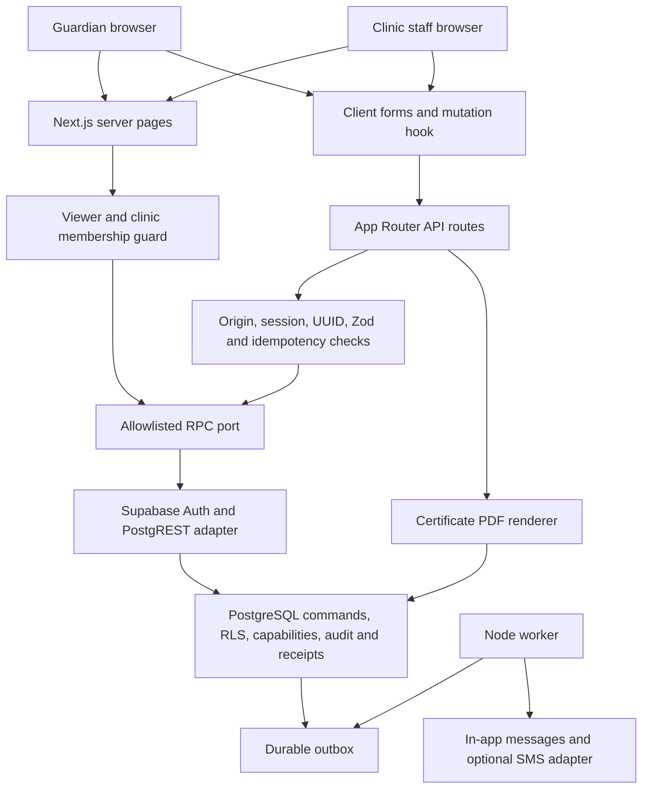

# CVSRS system map

Audit started 2026-09-30. Status: NEEDS REVIEW. Updated after implementation; this map records actual code, not a claim of production readiness.

## Scope and evidence

The audit covers `src`, all SQL migrations, tests, scripts, configuration and operations documentation. Three independent GPT-6 SOL audits cover the database/business rules, API/security, and UI/workflows. The lead consolidates findings and validation. Existing uncommitted work is preserved; its baseline diff is saved in `.local/audit-baseline.patch`. Work proceeds on `audit/production-quality-2026-09-30` in the supplied checkout so the user's uncommitted implementation remains available.

## Layers and boundaries

- Next.js 16 App Router, React 19, strict TypeScript, Tailwind 4, Zod 4. Server pages use the same authenticated RPC port as the API.
- No separate REST backend or ORM. Most business logic lives in `SECURITY DEFINER` SQL functions with explicit capability checks and empty search paths. Public tables have RLS; private schema owns audit, command receipts, outbox and documents.
- Supabase SSR manages application sessions; proxy refreshes cookies and sets nonce CSP. Local cookie authentication, development login routes and fictional setup accounts are removed. Disposable PostgreSQL exists only as a database test/worker harness.
- Client forms use local state and a shared mutation hook. A UUID operation key is retained across uncertain responses. Database command receipts provide transaction-level replay protection.
- Schedule rules come from clinic-supplied, separately approved versions. The SQL engine evaluates calendar ages, predecessor intervals, accepted products, evidence and holds. No medical policy is supplied by this audit.
- Stock moves through an append-only ledger and balance projection. Signed administration records revisions and stock issuance atomically. Corrections, evidence, schedules, content and access grants have review workflows.
- Certificates freeze a snapshot and store a rendered PDF in the private database. Storage requires current render generation and a server HMAC. Public verification exposes minimal metadata. A separately deployed restricted worker produces messages; real SMS transport is absent and production rejects the development sandbox.
- Shared application primitives now use semantic light/dark tokens, self-hosted typography and 44px controls. Provider behavior, browser rendering and manual accessibility remain unverified.
- All API routes use a shared Redis REST production limit (explicit override or default). Custom exports/downloads/callbacks and public verification use it too. Restricted callback and worker privilege groups have separate entry points and no table grants.

## Implemented workflow inventory

| Audience | Existing workflows | Current evidence |
|---|---|---|
| Public | Home, clinic information, sign-in/sign-up, certificate verification, ticket-only display | Code and build; production Auth unverified |
| Guardian | Provisional child registration, link request, privacy acknowledgement, child identity/history/schedule, booking/moving/cancelling visits, reported doses, edit requests, QR pass, certificates, record transfers, questions, messages/contact preferences | SQL integration tests; UI audit pending |
| Clinic registration | Search/register/confirm child, verify links, duplicate review, arrivals, queue transitions, sessions | SQL integration tests; concurrency and UI edge cases under audit |
| Clinical staff/lead | History/evidence, holds, administration/signing, exceptions/corrections, catch-up plans, questions, clinical master data and schedule lifecycle | SQL integration tests; clinical policy and real-user acceptance external |
| Inventory | Locations/lots/receipts, wastage, counts/approvals, reconciliation/trace, disposition, transfers/shortfall, cold-chain readings/limits/review | SQL integration tests; full browser exercise pending |
| Administration/operations | Two-person staff grants/revocation, clinic profile, privacy/content review, reports/CSV/paper tallies, follow-up, record transfer, audit search, backup/restore status and outage forms | Code and SQL tests; deployment/restore evidence pending |

Password recovery and PKCE callback are implemented with contract tests; actual provider verification remains open. Missing or intentionally deferred: evidence-file upload, multi-dose vial workflow, closure calendar, offline writes, cross-organization exchange, growth reference and deployed monitoring. These remain distinct from broken existing behavior.

Current source inventory: 31 page files and 126 route-handler files after recovery pages/callback and removal of development routes. The original counts below remain the discovery baseline.

## Validation baseline

- `npm run typecheck`: passed as first stage of `npm run check`.
- `npm run lint`: failed, 22 errors / 209 warnings; agent-tool directories are scanned and theme mounting fails a React hook rule.
- `npm run test:unit`: 35 tests passed across 6 files.
- `npm run test:db`: 280 tests passed across 17 files; setup rebuilt only disposable `cvsrs_test`.
- `npm run matrix:check`: 287 rows accepted (traceability consistency only).
- `npm run build`: passed (compilation does not prove production authentication or deployment).
- Browser validation unavailable at discovery: CUA inventory returned no apps/browsers, and creating an in-app browser reported unavailable. No screenshots, clicks, mobile rendering, keyboard or screen-reader claims follow from code inspection.

## Release boundary

Supabase staging Auth/MFA/PostgREST behavior, clinical schedule approval, privacy decisions, clinic acceptance, deployment worker/backup/monitoring and manual accessibility validation remain explicit release prerequisites. Local passing tests cannot substitute for them.
